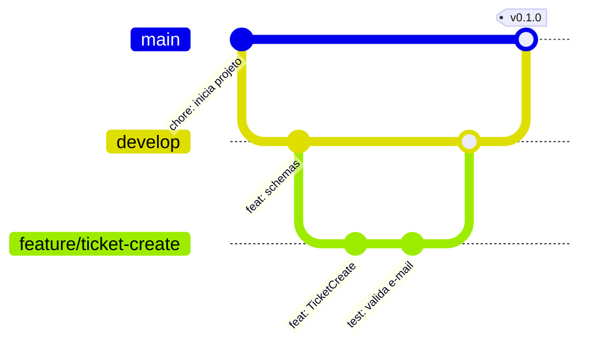

# Fluxo de branches do HelpDesk

| Branch | Função | Regra |
|---|---|---|
| `main` | Código estável, pronto para produção | Ninguém faz commit direto. Só recebe merge da `develop` |
| `develop` | Integração das funcionalidades | Recebe merges de `feature/*` via Pull Request |
| `feature/<nome>` | Uma tarefa por branch | Nasce da `develop`, morre após o merge |
| `hotfix/<nome>` | Correção urgente em produção | Nasce da `main` e volta para `main` e `develop` |

Nomes de branch: `feature/ticket-create`, `feature/login-jwt`, `hotfix/erro-status-chamado`.
