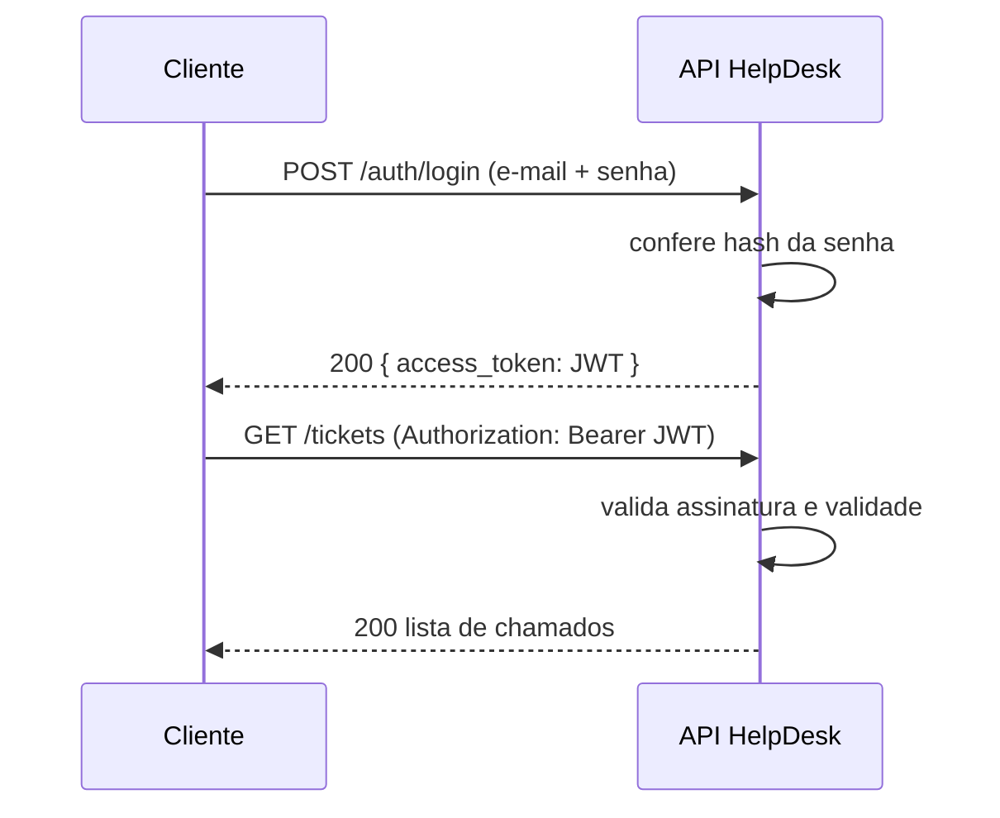

# Videoaula 8 — Como funciona a autenticação via Tokens JWT (10 min)

**Objetivo:** entender o JWT como um "crachá assinado": o servidor não guarda sessão, apenas confere a assinatura.



**Arquivos:** [`anatomia_jwt.py`](anatomia_jwt.py)

## Como rodar
```powershell
pip install pyjwt
python anatomia_jwt.py
```
(O script espera 3 segundos no final para demonstrar a expiração.)

## Roteiro de gravação
1. Analogia do crachá: recepção confere o documento uma vez e entrega o crachá; depois só se confere o crachá.
2. As 3 partes (`header.payload.signature`). Colar um token em <https://jwt.io> e mostrar o conteúdo.
3. **Payload não é secreto**: nunca colocar senha ou dados sensíveis.
4. Mostrar a adulteração falhando (assinatura) e a expiração (`exp`).
5. Claims comuns: `sub` (dono), `exp` (expira), `iat` (emitido em).
6. Cabeçalho `Authorization: Bearer <token>`.

## Quiz (Verdadeiro ou Falso) — material para a avaliação da Aula 4
| Afirmação | Resposta |
|---|---|
| O payload do JWT é criptografado | Falso (é só Base64; está **assinado**) |
| Mudar o payload invalida a assinatura | Verdadeiro |
| O servidor precisa guardar uma sessão por usuário | Falso (o JWT é *stateless*) |
| Senhas devem ser guardadas com hash de mão única | Verdadeiro |
| Hash e criptografia são a mesma coisa | Falso (hash não é reversível) |
| Um JWT expirado deve ser rejeitado | Verdadeiro |
