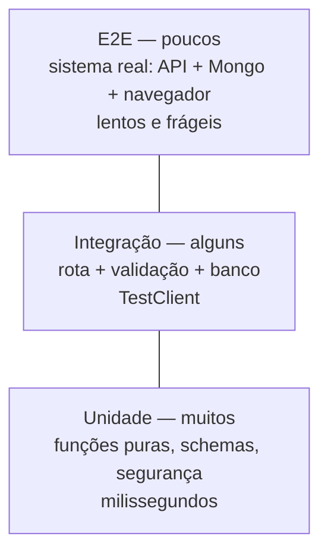

# Videoaula 11 — A Pirâmide de Testes no Backend (10 min)

**Objetivo:** saber *quantos* e *quais* testes escrever.



| Camada | O que testa | Velocidade | No HelpDesk |
|---|---|---|---|
| Unidade | Uma função/classe isolada | ms | validadores do Pydantic, hash de senha, criação do JWT |
| Integração | Peças trabalhando juntas | dezenas de ms | rota + validação + autenticação com `TestClient` |
| E2E | Sistema completo "de verdade" | segundos | API + MongoDB Atlas + chamada real |

**Regra prática:** muitos testes na base, poucos no topo. Se tudo for E2E, a suíte fica lenta e ninguém roda.

## Exemplo executável
[`exemplos/test_piramide.py`](exemplos/test_piramide.py) tem um teste de cada camada para a mesma regra (SLA).
```powershell
pip install pytest httpx fastapi
pytest exemplos -v                       # unidade + integração (o E2E é pulado)
$env:E2E_URL="http://127.0.0.1:8000"; pytest exemplos -v   # com a API no ar, o E2E também roda
```
Esperado sem `E2E_URL`: `5 passed, 1 skipped`.

## Roteiro de gravação
1. Pergunta: "Como sei que mexer no código não quebrou nada?"
2. Desenhar a pirâmide; custo x confiança de cada camada.
3. Rodar o arquivo de exemplo e apontar o `skipif` do E2E.
4. Gancho: na próxima videoaula instalamos o Pytest no projeto do HelpDesk.
