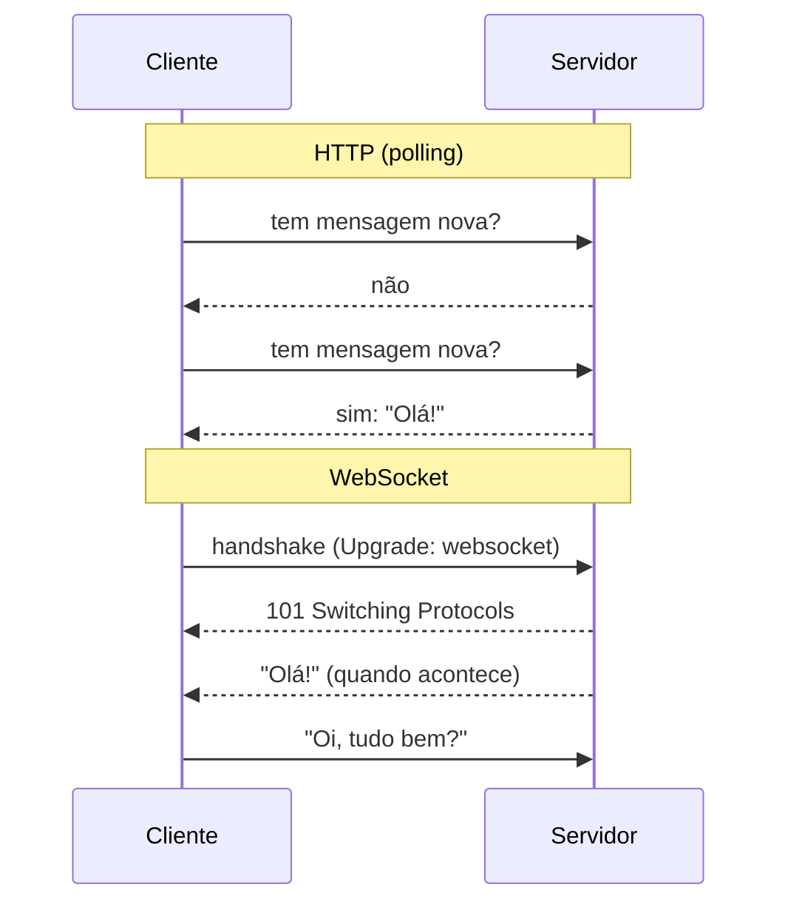

# Videoaula 1 — Protocolo WebSocket vs. requisições HTTP (10 min)

**Objetivo:** entender por que um chat precisa de WebSocket e ver o "eco" funcionando.

| | HTTP | WebSocket |
|---|---|---|
| Modelo | Pergunta -> resposta (e a conexão acaba) | Conexão **aberta** e contínua |
| Quem inicia a conversa | Sempre o cliente | Cliente **e** servidor |
| Custo por mensagem | Cabeçalhos completos a cada requisição | Quadros leves após o handshake |
| Para ver novidades | *Polling* (perguntar de tempos em tempos) | O servidor **empurra** (push) |
| Ideal para | CRUD, páginas, APIs | Chat, notificações, painéis ao vivo |
| Esquema na URL | `http://` / `https://` | `ws://` / `wss://` (seguro) |



**Arquivos**
- [`servidor_eco.py`](servidor_eco.py): rota HTTP `/hora` e WebSocket `/ws/eco` + página de teste.
- [`cliente_eco.py`](cliente_eco.py): cliente Python do WebSocket.

## Como rodar
```powershell
pip install fastapi "uvicorn[standard]" websockets
uvicorn servidor_eco:app --reload
# outro terminal:
python cliente_eco.py
```
Abra <http://127.0.0.1:8000/> para o teste no navegador (abra o DevTools -> Rede -> WS para ver os quadros).

## Roteiro de gravação
1. Problema: "como o cliente fica sabendo que o suporte respondeu?" (polling x push).
2. Mostrar `/hora` (HTTP) no navegador: cada F5 é uma requisição.
3. `@app.websocket(...)`, `accept()`, `receive_text()`, `send_text()`, `WebSocketDisconnect`.
4. Rodar `cliente_eco.py` e depois a página no navegador.
5. Observação: o **Swagger não documenta WebSockets**; por isso testamos com uma página/cliente.
